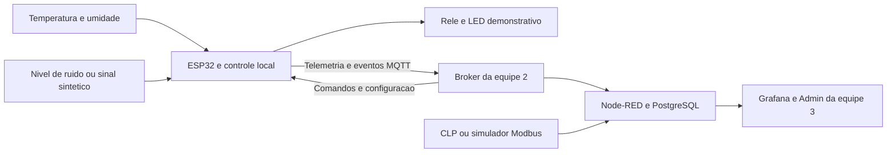

# Arquitetura proposta

**Proposta técnica para discussão.** Requisitos de origem: [[Requisitos e rastreabilidade]]. Nenhum bloco foi implementado nesta sessão.

A leitura Modbus pelo ESP32 é uma alternativa prevista no detalhamento do plano. O desenho mostra leitura no backend apenas como proposta de divisão, ainda dependente de [[Escopo e equipes]].

## Fronteiras funcionais

O ESP32 lê ambiente, valida dados, decide o comando do relé localmente e classifica a máquina. A indisponibilidade do MQTT não deve impedir o ciclo local. O broker transporta mensagens; PostgreSQL armazena histórico; Node-RED integra e gera regras de backend; Grafana apresenta dados.

A classificação acústica e o controle de UR são funções separadas. Detectar parada **não ordena parar a encapsuladora** e não desliga automaticamente o desumidificador. Qualquer intertravamento adicional exigiria um requisito e uma decisão específicos.

## Camadas sugeridas do firmware

Drivers de entrada → validação e unidades → controle de UR/classificação → estado publicado → MQTT. Configuração e persistência devem ficar separadas da leitura do sensor, permitindo trocar DHT22 por SHT31 e entrada sintética por áudio sem reescrever as regras.

Ver [[Hardware e componentes]], [[Firmware e estados]] e [[Contrato MQTT proposto]].
