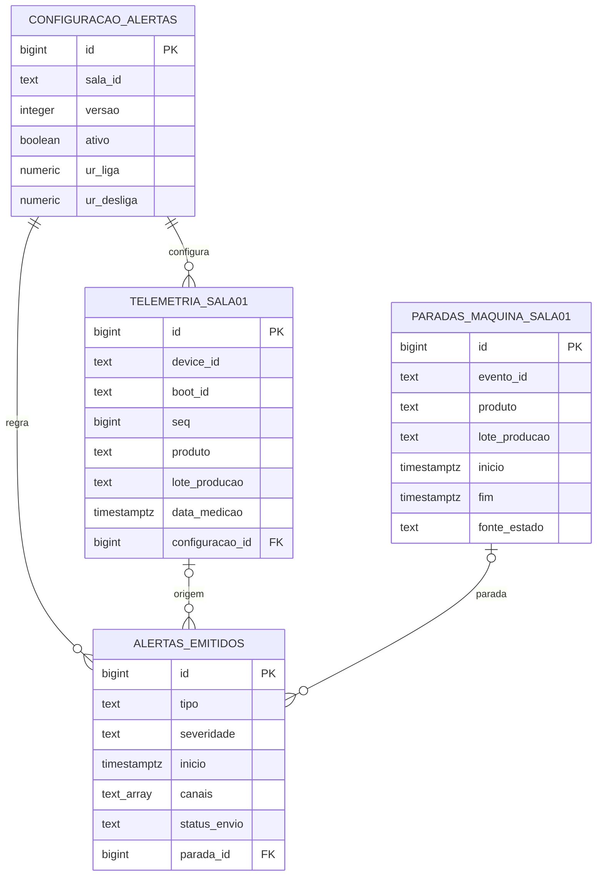

# Modelo de dados do item 1

Implementação proposta do script SQL do item 1, em `banco/01_schema.sql`. Referência: [[Transcricao integral dos entregaveis]], blocos 11, 20 e 25, e nomes do [[Transcricao integral do plano MVP]].

## Tabelas

| Tabela no schema mixnutri | Finalidade | Campos principais |
| --- | --- | --- |
| configuracao_alertas | Configuração versionada, uma ativa por sala | UR liga/desliga e `histerese_pp` calculada, temperaturas opcionais, limiares de ruído e unidade, confirmação temporal, UR de alerta, persistência do alerta, alerta de parada, canais dashboard/e-mail/Telegram e origem dos parâmetros |
| telemetria_sala01 | Uma linha por mensagem/leitura | Sala/dispositivo/reinício/sequência, tempo, produto, lote de produção, lotes de cápsula/pó, clima e qualidade, ruído/unidade, estado, modo e comando do relé |
| paradas_maquina_sala01 | Um intervalo de parada por evento | Sala/dispositivo/evento, produto/lote, fonte, início/fim, `motivo_fim`, duração, referência temporal e código de falha apenas quando vindo de Modbus |
| alertas_emitidos | Registro dos alertas gerados pelo backend (v2) | Tipo, severidade, início/fim, valor e limite com unidade, mensagem, canais, situação do envio, ligação opcional com telemetria e parada |

A associação entre telemetria e parada é uma consulta por sala, dispositivo, produto, lote e tempo, não uma chave que atribui causa. Produto/lote são repetidos intencionalmente por leitura/evento no MVP para preservar o contexto histórico. Um cadastro normalizado pode ser adicionado depois.

## Regras implementadas

- Produto e lote de produção obrigatórios e não vazios. Lote da cápsula e do pó ficam explícitos quando conhecidos; não inventar valores reais.
- UR entre 0 e 100, temperatura dentro dos limites de armazenamento adotados e valores coerentes com a qualidade. Leituras inválidas guardam NULL nos valores de clima.
- Unidades de ruído distintas: normalizado, ADC RMS, dBFS ou dB SPL. dBFS precisa ser ≤ 0. SPL exige referência de calibração registrada.
- Configuração exige ao menos um canal de alerta. Destinatários (e-mails, chats) não ficam no banco: ficam nas credenciais do backend, para não gravar dados pessoais nesta tabela.
- Alertas: canais só entre dashboard, e-mail e Telegram; alerta de parada exige `parada_id`; "enviado" exige horário de envio; no máximo um alerta aberto por tipo e sala.
- `motivo_fim` só em parada encerrada; valores esperados do firmware do item 2: `retorno_operacao`, `fonte_indisponivel`, `reinicio_dispositivo`, `encerramento_manual`.
- Chave sala/dispositivo/reinício/sequência evita duplicar mensagens da mesma origem.
- Início/fim coerentes; duração calculada; no máximo uma parada aberta por sala/dispositivo/fonte.
- Registros sintéticos são identificados como simulação.
- Configuração não aceita desligamento maior/igual ao ligamento; valores didáticos recebem origem específica.
- Horário de medição pode ser NULL quando não sincronizado; recebimento fica preservado separadamente.

As restrições verificam a estrutura, não a veracidade dos valores. Uma string de referência de calibração não prova que a calibração foi executada. Temperaturas de armazenamento no esquema não são faixas de qualidade da empresa.

## Exemplos e integração ainda pendente

`02_dados_demo.sql` insere uma configuração, dez leituras, uma parada e dois alertas (UR alta; UR alta coincidindo com parada), todos sintéticos. Desde a v2, o ruído dos exemplos está em dBFS, a mesma unidade publicada pelo firmware do item 2, com limiares −25/−35 dBFS. Os exemplos foram gerados pelo script; ainda não existe importação automática do MQTT para o banco.

`03_consultas.sql` lista leituras, a configuração ativa e os alertas com a parada associada, e calcula a maior UR nos 30 s anteriores a uma parada, preservando origem/produto/lote e referência temporal. Não calcula taxa de quebra nem conclui causalidade. A coleta de quantidade produzida/quebrada deverá ser modelada com as equipes e a empresa para cobrir [[Dados para investigar as quebras]].

Alinhar o script e o mapeamento de mensagens com a equipe 2 antes da integração. O modelo ainda não implementa o sistema de alertas, permissões de usuários, políticas de retenção do banco ou backend.
