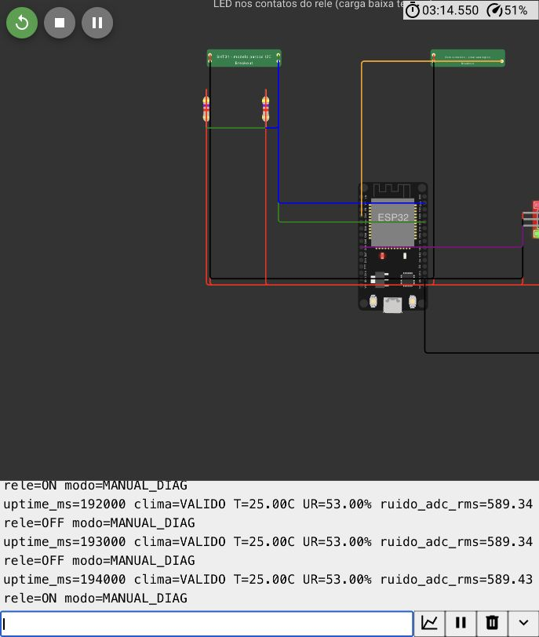

# Validação do item 1

## Versão 2 (27/10/2026, segunda sessão)

Mudanças: o chip `som` ganhou ruído de fundo (`ruidoFundoPercent`, padrão 5%) e o controle `online`; o diagnóstico passou a imprimir `ruido_dbfs`; o SQL passou a ter dBFS coerente, canais de alerta na configuração, `histerese_pp`, `motivo_fim` nas paradas e a tabela `alertas_emitidos`. A v1, abaixo, fica como histórico. O pacote v1 continua em `MixNutri_Item1_2026-10-27.zip`.

| ID | Procedimento executado | Resultado observado | Conclusão |
| --- | --- | --- | --- |
| I1-V2-W01 | Wokwi web com os 6 arquivos, conferidos por SHA-256 contra os locais | Compilou; clima VÁLIDO 25,00 °C / 45,00% UR; RMS ≈ 589, −10,8 dBFS | Aprovado |
| I1-V2-W02 | Comandos seriais `1` e `0` | `rele=ON` e depois `rele=OFF` | Aprovado; fiação e polaridade iguais à v1 |
| I1-V2-W03 | Chip `som`: tom 0% / ruído 5%, tom 0% / ruído 0%, tom 80%, `online=0`, `online=1` | RMS 6,69 (−49,7 dBFS); 0 (−66,2, piso); 590 (−10,8); 0; 589 | Caminho do sinal até o ADC demonstrado |
| I1-V2-C01 | Testes C dos modelos | 9 verificações OK, incluindo tom de 200 Hz, ruído limitado a ±0,3 V e saída 0 V desconectado | Aprovado |
| I1-V2-S01 | Schema v2, dados demo, consultas e 18 verificações em PostgreSQL 18.4 temporário, só socket local | 4 tabelas; 1 configuração, 10 leituras, 1 parada, 2 alertas; todas as rejeições esperadas ocorreram; ROLLBACK preservou os dados | Aprovado |

Histerese AUTO e falha de CRC do diagnóstico não foram repetidas na v2: esse código e o chip SHT31 não mudaram. O firmware do item 2 tem implementação própria dessas funções, testada à parte em [[Validacao do item 2]].

Evidências v2: [serial da revalidação](evidencias/wokwi-serial-revalidacao-v2.txt), [testes C](evidencias/modelos-validacao.txt), [PostgreSQL](evidencias/postgresql-validacao.txt). Os arquivos `wokwi.toml`, `platformio.ini` e `testes-wokwi/item1.test.yaml` foram preparados para o Wokwi CLI e não foram executados ([[Wokwi CLI e VS Code]]).

## Versão 1 — histórico

### Ambiente e versão

Execução em 27/10/2026. Circuito executado no Wokwi web com ESP32 DevKit V1 e modelos customizados locais. Programa final de diagnóstico: SHA-256 `e2453cf83b2743034c5749cb75dbc9fdb742536b41566ea5bc5378d6762cda9c`. Backend/MQTT não foi iniciado para essa simulação.

Os três scripts SQL e o teste de restrições foram executados em PostgreSQL 18, em cluster temporário com socket local e sem acesso TCP externo. A instância foi encerrada após os testes. Nenhum banco existente do usuário foi usado.

### Procedimento e resultado observado

| ID | Procedimento executado | Resultado observado | Conclusão no escopo |
| --- | --- | --- | --- |
| I1-W01 | Compilar e iniciar o circuito final | Programa e chips compilaram; serial registrou clima válido a 25,00 °C e 45,00% UR | Aprovado para modelos/driver demonstrados |
| I1-W02 | Enviar 1 e 0 pelo serial | Comando ON/OFF correspondeu ao LED nos contatos após correção para HIGH/LOW | Aprovado para a carga LED simulada |
| I1-W03 | Habilitar AUTO didático e variar UR: 60 → 53 → 49 → 53 | ON → ON → OFF → OFF | Histerese demonstrada no diagnóstico |
| I1-W04 | Ativar crcFault no modelo SHT31 | Clima FALHA, valores nan no serial e saída OFF em AUTO | Rejeição de CRC demonstrada; integração deve converter inválidos para NULL |
| I1-W05 | Reduzir amplitude de som sintético de 80% a 0% e restaurar | RMS ADC próximo de 589 → 0 → 589 | Caminho de sinal sintético até o ADC demonstrado |
| I1-C01 | Compilar testes C com clang e executar callbacks dos modelos | Vetor CRC conhecido, espera de 15 ms, status/reset, comando inválido, NACK, UR 0/100%, CRC injetado e limites de sinal passaram | Aprovado para os comportamentos implementados |
| I1-S01 | Executar schema e dados demo | Três tabelas, uma configuração, dez leituras e uma parada criadas | Aprovado no PostgreSQL de teste |
| I1-S02 | Executar consultas | Listagem coerente; consulta retornou UR máxima 60 e seis amostras anteriores à parada | Consulta temporal demonstrada, sem causalidade |
| I1-S03 | Rodar validações de rejeição com ROLLBACK | UR inválida, duplicidade, lote vazio, unidade/faixa incoerente, SPL sem referência, duração negativa e histerese inválida rejeitados | Aprovado para restrições exercitadas |
| I1-S04 | Registrar leitura inválida com NULL e finalizar parada | NULL aceito com qualidade inválida; duração calculada de 12 s; ROLLBACK preservou os dez registros demo | Aprovado para qualidade e duração |

No teste de falha de CRC, o relé já estava OFF antes da falha. O registro demonstra rejeição da leitura e manutenção de OFF, sem afirmar um teste de desligamento a partir de ON por falha. O modo de injeção `online=0` foi exercitado nos testes C, não como cenário final da UI.

Os tempos são de simulação, não necessariamente iguais ao tempo de relógio do computador. RMS ADC não é dB SPL e não valida sensibilidade acústica. O teste não aprova a classificação de uma máquina real.

### Evidências da v1

- [Log dos cenários Wokwi](evidencias/wokwi-serial-cenarios.txt).
- [Circuito em execução com carga LED ligada](evidencias/wokwi-circuito.png).
- [Captura ON](evidencias/wokwi-rele-on.png) e [captura OFF](evidencias/wokwi-rele-off.png).
- Saída dos testes C da v1: no pacote v1 (o arquivo atual é da v2).
- Execução PostgreSQL da v1: no pacote v1 (o arquivo atual é da v2).



### Histórico e correção do relé

A primeira tentativa usou polaridade invertida. A verificação da carga, em vez de apenas do texto serial, mostrou o problema. O código final usa `RELE_ON = HIGH` e `RELE_OFF = LOW` para o módulo `npn`. Os cenários foram repetidos na versão corrigida. Arquivos anteriores ficam em `evidencias/historico-antes-correcao` e não são evidência final da carga.

### O que não foi executado

MQTT, cliente Modbus, NVS, retenção/reenvio de dados offline, classificação acústica completa OPERANDO/PARADO, integração ESP32–PostgreSQL, Grafana/alertas, hardware físico e medições na fábrica. Os exemplos SQL foram inseridos manualmente pelo script. A [[Matriz de testes]] geral permanece para o firmware completo; os resultados acima pertencem ao diagnóstico do item 1.

### Reproduzir os testes C

A partir da pasta do pacote, em ambiente com clang, compilar para uma saída temporária e executar:

```sh
clang -std=c11 -Wall -Wextra -Werror -I testes testes/test_models.c -o /tmp/mixnutri-model-tests
/tmp/mixnutri-model-tests
```

O cabeçalho em `testes/wokwi-api.h` é um adaptador local; o Wokwi fornece sua própria API ao compilar os chips. Procedimento SQL em [[Entrega do item 1]].
