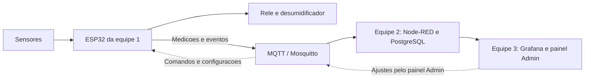

# MixNutri — Equipe 1

**Hardware e firmware para acompanhar o ambiente de uma sala de encapsulamento.**

Este projeto faz parte do Desafio 10 do NEOINDÚSTRIA MS, em parceria entre SENAI-MS e UCDB. A proposta é acompanhar temperatura, umidade e funcionamento da máquina para ajudar a investigar as quebras de cápsulas e apoiar melhorias no processo.

Somos a **equipe 1, responsável pelo circuito eletrônico e pela programação do ESP32**. Nosso trabalho é transformar as leituras dos sensores em informações úteis e fazer o controle local do desumidificador. Começamos com uma sala piloto e usamos simulação para desenvolver e testar a solução.

## O que fica com a nossa equipe

- **Medir temperatura e umidade** com o sensor SHT31 conectado ao ESP32.
- **Controlar o desumidificador por relé**, usando dois limites de umidade: um para ligar e outro para desligar. Isso evita que a saída fique ligando e desligando a cada pequena oscilação.
- **Identificar possíveis paradas pelo som da máquina**, confirmando a mudança por um intervalo de tempo para evitar alertas por ruídos passageiros.
- **Programar os modos automático e manual**, o recebimento de ajustes e a preservação de configurações e mensagens durante falhas de conexão.
- **Trocar informações por MQTT** com o sistema das outras equipes: enviar medições e eventos e receber comandos e configurações.

O controle de umidade acontece no próprio ESP32. A arquitetura foi pensada para que essa decisão local continue funcionando quando a conexão com o servidor estiver indisponível.

## Hardware e simulação

| Componente | Função |
| --- | --- |
| ESP32 | Lê os sensores, executa as regras e se comunica pela rede. |
| SHT31 | Fornece temperatura e umidade. |
| Entrada de som | Ajuda a distinguir funcionamento e possível parada da máquina. |
| Relé e LED | Representam o acionamento do desumidificador durante a simulação. |

O desenvolvimento começa no **Wokwi**. Na versão simulada, usamos um modelo parcial do SHT31 e um sinal sonoro sintético. Isso permite testar a lógica; o comportamento dos sensores e do equipamento físico ainda precisa ser avaliado em campo.

## Como nossa parte conversa com as outras equipes

A comunicação usa **MQTT**, um protocolo para trocar mensagens. O **Mosquitto** funciona como a central que recebe essas mensagens e as encaminha ao destino.

**Nós enviamos** temperatura, umidade, nível de ruído, estado estimado da máquina e comando do desumidificador, com identificação e contexto de produto e lote. **Nós recebemos** ajustes de limites, seleção AUTO/MANUAL e comandos de acionamento.

- **Equipe 2:** cuida da infraestrutura, recebe as mensagens, integra os dados e mantém o histórico no banco PostgreSQL.
- **Equipe 3:** apresenta os dados no Grafana e oferece o painel de ajustes no Node-RED.

Depois de uma alteração no painel, a configuração segue pelo MQTT até o ESP32. O firmware verifica o pedido, aplica o que for válido e devolve uma confirmação. Os formatos das mensagens e as regras de integração precisam ser combinados entre as equipes.

Como alternativa ao som, o projeto também prevê **Modbus TCP** para consultar o estado da máquina no controlador industrial, caso o acesso seja autorizado e a integração seja definida.

## Em que etapa estamos

Situação em 28/10/2026:

| Entrega | Situação | Onde ver |
| --- | --- | --- |
| **Item 1:** circuito no Wokwi e script SQL | Pronto (versão 2) e testado no Wokwi e no PostgreSQL | [Projeto no Wokwi](https://wokwi.com/projects/479079864657061889) · [pasta](MixNutri/06%20Entregas/Item%201) |
| **Item 2:** firmware do ESP32 | Pronto e testado no Wokwi com MQTT de verdade, inclusive queda de rede e reinício sem perder mensagens | [Projeto no Wokwi](https://wokwi.com/projects/479080199406642177) · [pasta](MixNutri/06%20Entregas/Item%202) |
| **Item 3:** ambiente de integração | Proposta da equipe 1 para a equipe 2 avaliar; arquivos prontos, ainda não executados | [pasta](MixNutri/06%20Entregas/Item%203%20%28proposta%29) |
| **Itens 4 e 5:** dashboard e teste integrado | Com as equipes 2 e 3 | — |

Os valores usados na simulação são demonstrativos. O nível de ruído sai em **dBFS**, uma medida relativa ao conversor do ESP32, e não em dB SPL: o sinal sonoro é sintético e não representa uma medição acústica calibrada. A proximidade entre umidade alta e uma parada não comprova a causa das quebras. Essa investigação depende de dados reais de produção e qualidade.

## Para as outras equipes

- **Mensagens MQTT:** tópicos, campos e exemplos reais estão no [contrato MQTT](MixNutri/02%20Equipe%201/Contrato%20MQTT%20proposto.md), seção "Versão 2". O [log das mensagens recebidas](MixNutri/06%20Entregas/Item%202/evidencias/mqtt-recebido-execucao-final.log) mostra o que o ESP32 publica.
- **Banco de dados:** o [schema](MixNutri/06%20Entregas/Item%201/banco/01_schema.sql) tem as tabelas de telemetria, paradas, configuração de alertas e alertas emitidos, com os mesmos nomes de campo das mensagens.
- **Ferramenta de teste:** o [mqtt_mini.py](MixNutri/06%20Entregas/Item%202/ferramentas/mqtt_mini.py) assina e publica no broker sem instalar nada além do Python.
- **Compatibilidade:** a [análise da entrega das etapas 3 e 4](MixNutri/06%20Entregas/Item%203%20%28proposta%29/Compatibilidade%20com%20a%20entrega%20das%20etapas%203%20e%204.md) lista as diferenças entre os contratos e as perguntas em aberto.

Tudo isso é proposta para combinarmos juntos. Nenhum formato foi fechado entre as equipes ainda.

## Como o repositório está organizado

A pasta `MixNutri` também é um cofre do Obsidian: os links `[[assim]]` funcionam lá, e no GitHub aparecem como texto.

| Pasta | Conteúdo |
| --- | --- |
| `00 Contexto`, `01 Projeto` | Visão do desafio, escopo das equipes, requisitos e cronograma |
| `02 Equipe 1` | Arquitetura, controle de umidade, detecção de parada, parâmetros e contrato MQTT |
| `03 Simulacao` | Plano e limites da simulação, matriz de testes, evidências e uso do Wokwi CLI |
| `04 Memoria` | Decisões, pendências, tarefas e o registro de cada sessão de trabalho |
| `06 Entregas` | Itens 1, 2 e 3 com código, instruções, validação e evidências |
| `90 Fontes` | Referências técnicas e a entrega recebida da outra equipe (etapas 3 e 4) |

Ficaram fora deste repositório público os documentos originais do desafio, as transcrições deles e os contatos da coordenação: o material do desafio tem distribuição restrita ao SENAI-MS, à UCDB e à empresa. Senhas também não são publicadas; o ambiente do item 3 traz só um modelo (`.env.exemplo`).
