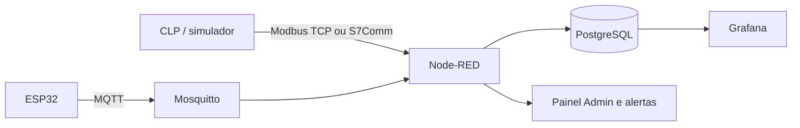

# Memorial técnico — Etapas 3 e 4

## Etapa 3 — Comunicação, broker e integração industrial

A infraestrutura da Sala Piloto é executada em contêineres Docker coordenados por Docker Compose. O ambiente reúne Mosquitto como broker MQTT, PostgreSQL como repositório, Node-RED como camada de integração e Grafana para visualização. Um simulador Modbus TCP compõe a bancada virtual e permite exercitar a leitura dos registradores antes de conectar qualquer equipamento industrial. Os serviços são iniciados por um único comando e os dados ficam em volumes persistentes.

O ESP32 publica amostras em `iotmixnutri/sala01/telemetria`, com umidade relativa, temperatura, ruído, estado da máquina e estado do desumidificador. O Node-RED valida o payload, converte unidades quando necessário e grava as medições em `telemetria_sala01`. Comandos remotos AUTO/MANUAL usam `iotmixnutri/sala01/comando`; o controle por histerese continua local no microcontrolador, de modo que uma indisponibilidade de rede não interrompa a estratégia de segurança do processo.

Para a coleta digital da máquina, foi definido um mapa FC03 Modbus TCP com registradores de umidade, temperatura, ruído, estado, relé e falha. A integração com um CLP Siemens S7Comm também está preparada em uma aba opcional do Node-RED. Como endereço IP, rack/slot e mapa de DB variam conforme o CLP real, essa aba fica desabilitada até a confirmação desses parâmetros pela equipe de Controle e Automação. A coleta S7 prevista é somente de leitura. Assim, o MVP demonstra os dois caminhos digitais possíveis sem assumir um mapa de processo que ainda não foi fornecido.

## Etapa 4 — Dashboard, administração e alertas

O dashboard operacional Grafana é provisionado junto do ambiente e consulta o PostgreSQL com um usuário de leitura. Os painéis acompanham umidade relativa, temperatura, nível de ruído, estado da máquina, acionamento do desumidificador, eventos de parada e histórico de alertas. A atualização periódica permite observar a sequência temporal entre variação ambiental, acionamento do desumidificador e parada da máquina.

O painel de administração Node-RED permite ajustar umidade máxima, histerese, limiar de ruído e duração mínima para classificar parada. Também disponibiliza comandos de demonstração para retorno ao modo automático e acionamento manual do desumidificador. Os limites são gravados na tabela `configuracao_alertas`. Quando a umidade ultrapassa o limite configurado ou a máquina é classificada como parada, o sistema apresenta uma notificação no painel e registra o evento em `alertas_sala01`; Telegram e e-mail podem ser habilitados por variáveis de ambiente.

## Critérios de validação

1. Subir os serviços com `docker compose up --build -d` e confirmar estado saudável do broker, banco e simulador.
2. Confirmar que o Node-RED recebe leituras Modbus FC03 e que linhas aparecem em `telemetria_sala01`.
3. Publicar uma telemetria MQTT com UR acima do limite e observar um alerta no painel e em `alertas_sala01`.
4. Alterar limites no painel Admin e confirmar persistência em `configuracao_alertas`.
5. Simular estado PARADO por Modbus ou nível de ruído baixo pelo período configurado e confirmar abertura do evento; ao voltar a OPERANDO, confirmar o horário de fim.
6. Consultar no Grafana os gráficos e os registros gerados pela simulação.
7. Opcionalmente, configurar um bot/chat Telegram e/ou SMTP de teste e verificar o recebimento do alerta.

## Limitações da demonstração

Os valores do servidor Modbus são simulados. A integração S7Comm requer IP e endereços de DB validados, e as notificações externas requerem credenciais. O painel admin está preparado para uso local de bancada; uma implantação operacional exigiria autenticação, TLS, controle de acesso, credenciais próprias do broker e revisão das permissões de rede.

## Referências técnicas

- Docker Compose: https://docs.docker.com/compose/
- Mosquitto: https://mosquitto.org/documentation/
- Node-RED: https://nodered.org/docs/
- FlowFuse Dashboard: https://dashboard.flowfuse.com/
- Grafana provisioning e PostgreSQL datasource: https://grafana.com/docs/grafana/latest/
- Integração S7 para Node-RED: https://github.com/st-one-io/node-red-contrib-s7
- Integração Modbus para Node-RED: https://github.com/BiancoRoyal/node-red-contrib-modbus
