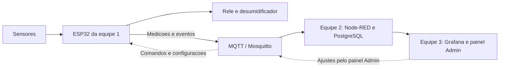

# MixNutri — Equipe 1

**Hardware e firmware para acompanhar o ambiente de uma sala de encapsulamento.**

Este projeto faz parte do Desafio 10 do NEOINDÚSTRIA MS, em parceria entre SENAI-MS e UCDB. A proposta é acompanhar temperatura, umidade e funcionamento da máquina para ajudar a investigar as quebras de cápsulas e apoiar melhorias no processo.

Somos a **equipe 1, responsável pelo circuito eletrônico e pela programação do ESP32**. Nosso trabalho é transformar as leituras dos sensores em informações úteis e fazer o controle local do desumidificador. Começamos com uma sala piloto e usamos simulação para desenvolver e testar a solução.

## O que fica com a nossa equipe

- **Medir temperatura e umidade** com o sensor SHT31 conectado ao ESP32.
- **Controlar o desumidificador por relé**, usando dois limites de umidade: um para ligar e outro para desligar. Isso evita que a saída fique ligando e desligando a cada pequena oscilação.
- **Identificar possíveis paradas pelo som da máquina**, confirmando a mudança por um intervalo de tempo para evitar alertas por ruídos passageiros.
- **Programar os modos automático e manual**, o recebimento de ajustes e a preservação de configurações e mensagens durante falhas de conexão.
- **Trocar informações por MQTT** com o sistema das outras equipes: enviar medições e eventos e receber comandos e configurações.

O controle de umidade acontece no próprio ESP32. A arquitetura foi pensada para que essa decisão local continue funcionando quando a conexão com o servidor estiver indisponível.

## Hardware e simulação

**Para simular no Wokwi, não é necessário comprar componentes.** O circuito dos itens 1 e 2 usa um ESP32 DevKit V1, um modelo parcial do SHT31, um gerador de som sintético e um relé que aciona um LED. O comportamento dos sensores e do equipamento físico ainda precisa ser avaliado em bancada e em campo.

### Componentes para uma bancada física

A lista abaixo é uma **proposta para um nó de uma sala**, baseada no circuito e nas interfaces do firmware atual. Os modelos comerciais são referências para seleção; ainda não foram testados fisicamente neste projeto.

| Quantidade | Componente específico | Função e especificação |
| --- | --- | --- |
| 1 | **DOIT ESP32 DevKit V1, com ESP32-WROOM-32 e Flash de 4 MB** | Placa principal, com Wi-Fi e USB para programação. É a referência correspondente ao ESP32 clássico usado na simulação. |
| 1 | **Módulo SHT31-D/SHT31-DIS com interface I²C**, por exemplo Adafruit **2857** | Mede temperatura e umidade. Alimentar em **3,3 V** e manter endereço **0x44**, conforme o firmware. Escolher módulo pronto, com pinos acessíveis. |
| 1 | **Módulo de microfone de eletreto com MAX9814 e saída analógica**, por exemplo Adafruit **1713** | Referência para substituir o som sintético. Alimentação em **3,3 V**; saída OUT ligada ao ADC do ESP32. A seleção depende de testes para distinguir máquina ligada e parada. |
| 1 | **Módulo relé de 1 canal, ativo em HIGH, com entrada compatível com lógica de 3,3 V** | Referência de bancada: **Seeed Grove Relay V1.2**, alimentado em **5 V**. Deve incluir o circuito de acionamento da bobina. Um módulo equivalente precisa atender à mesma lógica e tensão de entrada. |
| 1 | **LED verde de 5 mm** | Representa o desumidificador na bancada, ligado pelos contatos normalmente abertos do relé. |
| 1 | **Resistor de 330 Ω, ¼ W** | Limita a corrente do LED verde. |
| Até 2 | **Resistores de 4,7 kΩ, ¼ W** | Pull-ups de SDA e SCL para 3,3 V, presentes na simulação. No físico, acrescentar somente se o módulo não tiver pull-ups adequados; o Adafruit 2857 já os inclui. |
| 1 | **Protoboard de aproximadamente 830 pontos** | Montagem inicial dos módulos e do LED. |
| 1 kit | **Jumpers macho–macho e macho–fêmea** | Interligação da placa e dos módulos. Para o Grove, incluir cabo adaptador **Grove para pinos de 2,54 mm**. |
| 1 | **Cabo USB-A para micro-USB com transmissão de dados** | Programação e alimentação da placa de referência pelo computador. |
| 1, se operar sem computador | **Fonte USB regulada de 5 V / 1 A** | Referência inicial para alimentar a bancada; confirmar o consumo na montagem. Não alimenta o desumidificador. |

O LED azul de rede usa o **GPIO2**, já integrado na placa de referência. Se a placa adquirida não o tiver, acrescentar um LED azul e um resistor de 330 Ω.

Referências técnicas dos componentes: [placa DOIT ESP32 DevKit V1](https://docs.zephyrproject.org/latest/boards/others/doit_esp32_devkit_v1/doc/index.html), [módulo SHT31-D](https://www.adafruit.com/product/2857), [microfone MAX9814](https://www.adafruit.com/product/1713) e [Grove Relay, incluindo diferenças entre versões](https://wiki.seeedstudio.com/Grove-Relay/).

### Pinagem usada no projeto

| Sinal | Pino do ESP32 | Ligação |
| --- | --- | --- |
| SHT31 — SDA | **GPIO21** | Dados I²C, com pull-up para 3,3 V. |
| SHT31 — SCL | **GPIO22** | Clock I²C, com pull-up para 3,3 V. |
| Microfone — OUT | **GPIO34 / ADC** | Entrada analógica; sinal dentro da faixa de 0 a 3,3 V. |
| Relé — IN/SIG | **GPIO26** | **HIGH liga / LOW desliga** no circuito atual. |
| Relé — VCC e GND | **5 V da alimentação da bancada e GND comum** | Alimentação do módulo de referência; IN/SIG recebe apenas a lógica de 3,3 V. |
| LED de rede | **GPIO2** | Indicador integrado à placa. |
| Alimentação dos sensores | **3V3 e GND** | SHT31 e microfone com terra comum ao ESP32 e ao módulo relé. |

Na carga demonstrativa, a ligação é **3V3 → contato normalmente aberto do relé → resistor de 330 Ω → LED verde → GND**. No módulo simulado, isso usa COM–NO; o contato NC fica livre. A pinagem completa está na [documentação do circuito](MixNutri/06%20Entregas/Item%201/Pinagem%20e%20componentes%20do%20item%201.md).

### O que ainda precisa ser definido para o equipamento real

- **Captação de som:** o MAX9814 tem controle automático de ganho, que altera a amplitude; será necessário caracterizar seu comportamento e ajustar os limites de detecção. O INMP441 citado como alternativa usa I²S e exigiria outra interface de aquisição no firmware atual, que lê áudio analógico no GPIO34. O resultado atual em dBFS não é uma medição calibrada de dB SPL.
- **Acionamento do desumidificador:** ainda faltam modelo, tensão, corrente de partida e interface de comando. Esses dados determinam relé/contator ou SSR, proteções e montagem em caixa apropriada. O relé de bancada não está dimensionado para essa carga industrial.
- **Infraestrutura compartilhada:** é necessária uma rede Wi-Fi de **2,4 GHz** e um computador ou servidor para MQTT e os serviços das outras equipes. O ESP32 já oferece Wi-Fi, e o armazenamento local usa a Flash interna via LittleFS; o desenho atual não exige cartão SD nem módulo Ethernet. A alternativa Modbus TCP depende de acesso ao controlador e não implica um adaptador RS-485.

A passagem ao físico também exige configurar a rede e validar sensores, alimentação e limites de controle. Esta lista documenta a montagem proposta; os resultados existentes continuam sendo os da simulação.

## Como nossa parte conversa com as outras equipes

A comunicação usa **MQTT**, um protocolo para trocar mensagens. O **Mosquitto** funciona como a central que recebe essas mensagens e as encaminha ao destino.

**Nós enviamos** temperatura, umidade, nível de ruído, estado estimado da máquina e comando do desumidificador, com identificação e contexto de produto e lote. **Nós recebemos** ajustes de limites, seleção AUTO/MANUAL e comandos de acionamento.

- **Equipe 2:** cuida da infraestrutura, recebe as mensagens, integra os dados e mantém o histórico no banco PostgreSQL.
- **Equipe 3:** apresenta os dados no Grafana e oferece o painel de ajustes no Node-RED.

Depois de uma alteração no painel, a configuração segue pelo MQTT até o ESP32. O firmware verifica o pedido, aplica o que for válido e devolve uma confirmação. Os formatos das mensagens e as regras de integração precisam ser combinados entre as equipes.

Como alternativa ao som, o projeto também prevê **Modbus TCP** para consultar o estado da máquina no controlador industrial, caso o acesso seja autorizado e a integração seja definida.

## Em que etapa estamos

Situação em 28/10/2026:

| Entrega | Situação | Onde ver |
| --- | --- | --- |
| **Item 1:** circuito no Wokwi e script SQL | Pronto (versão 2) e testado no Wokwi e no PostgreSQL | [Projeto no Wokwi](https://wokwi.com/projects/479079864657061889) · [pasta](MixNutri/06%20Entregas/Item%201) |
| **Item 2:** firmware do ESP32 | Pronto e testado no Wokwi com MQTT de verdade, inclusive queda de rede e reinício sem perder mensagens | [Projeto no Wokwi](https://wokwi.com/projects/479080199406642177) · [pasta](MixNutri/06%20Entregas/Item%202) |
| **Item 3:** ambiente de integração | Proposta da equipe 1 para a equipe 2 avaliar; arquivos prontos, ainda não executados | [pasta](MixNutri/06%20Entregas/Item%203%20%28proposta%29) |
| **Itens 4 e 5:** dashboard e teste integrado | Com as equipes 2 e 3 | — |

Os valores usados na simulação são demonstrativos. O nível de ruído sai em **dBFS**, uma medida relativa ao conversor do ESP32, e não em dB SPL: o sinal sonoro é sintético e não representa uma medição acústica calibrada. A proximidade entre umidade alta e uma parada não comprova a causa das quebras. Essa investigação depende de dados reais de produção e qualidade.

## Para as outras equipes

- **Mensagens MQTT:** tópicos, campos e exemplos reais estão no [contrato MQTT](MixNutri/02%20Equipe%201/Contrato%20MQTT%20proposto.md), seção "Versão 2". O [log das mensagens recebidas](MixNutri/06%20Entregas/Item%202/evidencias/mqtt-recebido-execucao-final.log) mostra o que o ESP32 publica.
- **Banco de dados:** o [schema](MixNutri/06%20Entregas/Item%201/banco/01_schema.sql) tem as tabelas de telemetria, paradas, configuração de alertas e alertas emitidos, com os mesmos nomes de campo das mensagens.
- **Ferramenta de teste:** o [mqtt_mini.py](MixNutri/06%20Entregas/Item%202/ferramentas/mqtt_mini.py) assina e publica no broker sem instalar nada além do Python.
- **Compatibilidade:** a [análise da entrega das etapas 3 e 4](MixNutri/06%20Entregas/Item%203%20%28proposta%29/Compatibilidade%20com%20a%20entrega%20das%20etapas%203%20e%204.md) lista as diferenças entre os contratos e as perguntas em aberto.

Tudo isso é proposta para combinarmos juntos. Nenhum formato foi fechado entre as equipes ainda.

## Como o repositório está organizado

A pasta `MixNutri` também é um cofre do Obsidian: os links `[[assim]]` funcionam lá, e no GitHub aparecem como texto.

| Pasta | Conteúdo |
| --- | --- |
| `00 Contexto`, `01 Projeto` | Visão do desafio, escopo das equipes, requisitos e cronograma |
| `02 Equipe 1` | Arquitetura, controle de umidade, detecção de parada, parâmetros e contrato MQTT |
| `03 Simulacao` | Plano e limites da simulação, matriz de testes, evidências e uso do Wokwi CLI |
| `04 Memoria` | Decisões, pendências, tarefas e o registro de cada sessão de trabalho |
| `06 Entregas` | Itens 1, 2 e 3 com código, instruções, validação e evidências |
| `90 Fontes` | Referências técnicas e a entrega recebida da outra equipe (etapas 3 e 4) |

Ficaram fora deste repositório público os documentos originais do desafio, as transcrições deles e os contatos da coordenação: o material do desafio tem distribuição restrita ao SENAI-MS, à UCDB e à empresa. Senhas também não são publicadas; o ambiente do item 3 traz só um modelo (`.env.exemplo`).
