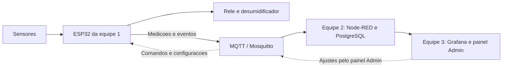

# MixNutri — Equipe 1

**Hardware e firmware para acompanhar o ambiente de uma sala de encapsulamento.**

Este projeto faz parte do Desafio 10 do NEOINDÚSTRIA MS, em parceria entre SENAI-MS e UCDB. A proposta é acompanhar temperatura, umidade e funcionamento da máquina para ajudar a investigar as quebras de cápsulas e apoiar melhorias no processo.

Somos a **equipe 1, responsável pelo circuito eletrônico e pela programação do ESP32**. Nosso trabalho é transformar as leituras dos sensores em informações úteis e fazer o controle local do desumidificador. Começamos com uma sala piloto e usamos simulação para desenvolver e testar a solução.

## O que fica com a nossa equipe

- **Medir temperatura e umidade** com o sensor SHT31 conectado ao ESP32.
- **Controlar o desumidificador por relé**, usando dois limites de umidade: um para ligar e outro para desligar. Isso evita que a saída fique ligando e desligando a cada pequena oscilação.
- **Identificar possíveis paradas pelo som da máquina**, confirmando a mudança por um intervalo de tempo para evitar alertas por ruídos passageiros.
- **Programar os modos automático e manual**, o recebimento de ajustes e a preservação de configurações e mensagens durante falhas de conexão.
- **Trocar informações por MQTT** com o sistema das outras equipes: enviar medições e eventos e receber comandos e configurações.

O controle de umidade acontece no próprio ESP32. A arquitetura foi pensada para que essa decisão local continue funcionando quando a conexão com o servidor estiver indisponível.

## Hardware e simulação

| Componente | Função |
| --- | --- |
| ESP32 | Lê os sensores, executa as regras e se comunica pela rede. |
| SHT31 | Fornece temperatura e umidade. |
| Entrada de som | Ajuda a distinguir funcionamento e possível parada da máquina. |
| Relé e LED | Representam o acionamento do desumidificador durante a simulação. |

O desenvolvimento começa no **Wokwi**. Na versão simulada, usamos um modelo parcial do SHT31 e um sinal sonoro sintético. Isso permite testar a lógica; o comportamento dos sensores e do equipamento físico ainda precisa ser avaliado em campo.

## Como nossa parte conversa com as outras equipes

A comunicação usa **MQTT**, um protocolo para trocar mensagens. O **Mosquitto** funciona como a central que recebe essas mensagens e as encaminha ao destino.

**Nós enviamos** temperatura, umidade, nível de ruído, estado estimado da máquina e comando do desumidificador, com identificação e contexto de produto e lote. **Nós recebemos** ajustes de limites, seleção AUTO/MANUAL e comandos de acionamento.

- **Equipe 2:** cuida da infraestrutura, recebe as mensagens, integra os dados e mantém o histórico no banco PostgreSQL.
- **Equipe 3:** apresenta os dados no Grafana e oferece o painel de ajustes no Node-RED.

Depois de uma alteração no painel, a configuração segue pelo MQTT até o ESP32. O firmware verifica o pedido, aplica o que for válido e devolve uma confirmação. Os formatos das mensagens e as regras de integração precisam ser combinados entre as equipes.

Como alternativa ao som, o projeto também prevê **Modbus TCP** para consultar o estado da máquina no controlador industrial, caso o acesso seja autorizado e a integração seja definida.

## Em que etapa estamos

Já executamos uma versão do circuito e do programa de diagnóstico no Wokwi, verificando leituras, acionamento do relé, histerese e falha de leitura. O firmware principal está em desenvolvimento, e a comunicação completa com o banco, os painéis e os alertas ainda precisa ser validada em conjunto.

Os valores usados na simulação são demonstrativos. O sinal sonoro não representa uma medição acústica calibrada, e a proximidade entre umidade alta e uma parada não comprova a causa das quebras. Essa investigação depende de dados reais de produção e qualidade.
