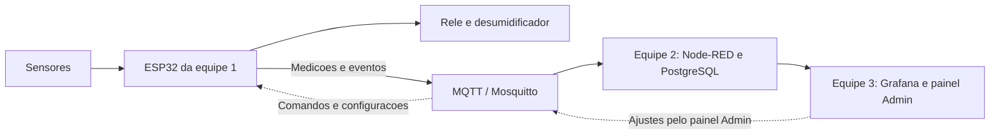

# MixNutri — Equipe 1

**Hardware e firmware para acompanhar o ambiente de uma sala de encapsulamento.**

Este projeto faz parte do Desafio 10 do NEOINDÚSTRIA MS, em parceria entre SENAI-MS e UCDB. A linha de encapsulamento tem quebras de cápsulas sem causa conhecida, e hoje a umidade é anotada à mão uma vez por dia. A proposta é medir temperatura e umidade continuamente, registrar quando a máquina para e cruzar esses dados com produto e lote, para ajudar a investigar as quebras.

Somos a **equipe 1, responsável pelo circuito eletrônico e pela programação do ESP32**. Começamos por uma sala piloto, com um único kit, e usamos simulação para desenvolver e testar antes de montar.

**Experimente agora no navegador, sem instalar nada:**

- [Item 1 — circuito e diagnóstico no Wokwi](https://wokwi.com/projects/479079864657061889)
- [Item 2 — firmware completo no Wokwi](https://wokwi.com/projects/479080199406642177)

## O que tem aqui

| Pasta | O que é | Como rodar |
| --- | --- | --- |
| [`item1-circuito-sql`](item1-circuito-sql) | Circuito do Wokwi, programa de diagnóstico e script SQL do banco | Wokwi no navegador; SQL com `psql` |
| [`item2-firmware`](item2-firmware) | Firmware do ESP32 e ferramenta de teste MQTT | Wokwi no navegador ou gravado no ESP32 |
| [`item3-integracao`](item3-integracao) | Kit com o lado do servidor: Mosquitto, PostgreSQL, Node-RED com painel Admin e Grafana | `docker compose up` |

Cada pasta tem o seu README com o passo a passo.

## O que o ESP32 faz

- **Mede temperatura e umidade** com o sensor SHT31.
- **Liga e desliga o desumidificador por relé com histerese:** liga acima de um limite (ex.: 55% UR) e só desliga abaixo de outro (ex.: 50% UR). Um tempo mínimo entre comutações protege o compressor. Se o sensor falhar, o desumidificador desliga.
- **Percebe se a máquina parou pelo som:** se o ruído cai e continua baixo por alguns segundos, registra uma parada com início, fim e duração. Um silêncio rápido não conta.
- **Conversa por MQTT:** envia medições a cada 5 s e eventos sempre que algo muda, todos com produto e lote. Recebe comandos AUTO/MANUAL, novos limites e o lote em produção, e responde a cada pedido dizendo se aceitou ou por que recusou.
- **Não perde dados quando a rede cai:** guarda as mensagens na memória Flash e reenvia em ordem quando a conexão volta, mesmo depois de reiniciar. O controle da umidade continua funcionando sem rede.
- **Modbus TCP opcional:** se a empresa liberar o acesso ao CLP da máquina, o estado pode vir direto dele em vez do som. Vem desligado por padrão.

## Hardware do MVP

Para simular no Wokwi não é preciso comprar nada. Para a montagem física escolhemos o caminho mais simples: **uma placa ESP32 clássica e módulos prontos**, sem placa de circuito própria e sem solda. Tudo vai na protoboard, alimentado pelo USB.

É a mesma placa e são os mesmos pinos da simulação. Para gravar no kit real, basta copiar `config_local.h.exemplo` para `config_local.h` e preencher o Wi-Fi e o broker; esse arquivo fica fora do git. A gravação na placa física ainda não foi testada.

| Qtd. | Componente | Para quê |
| --- | --- | --- |
| 1 | Placa **ESP32 DevKit V1** (ESP32-WROOM-32, 4 MB) | Cérebro do kit: lê sensores, controla o relé, Wi-Fi. O LED azul da placa serve de indicador de rede |
| 1 | Módulo **SHT31** (I²C, 3,3 V, endereço 0x44) | Temperatura e umidade. Os módulos prontos já trazem os resistores de pull-up |
| 1 | Módulo de microfone **MAX9814** (saída analógica) | Nível de ruído da máquina |
| 1 | Módulo **relé 1 canal** 5 V, **ativo em HIGH**, que aceite sinal de 3,3 V | Liga o desumidificador. Se o módulo for ativo em LOW, basta inverter `RELE_ON`/`RELE_OFF` no `sketch.ino` |
| 1 | LED + resistor de 330 Ω | Carga de demonstração ligada pelo relé |
| — | Protoboard, jumpers, cabo micro-USB **de dados** e fonte USB 5 V | Montagem, gravação e alimentação |

As ligações são iguais às do Wokwi:

| Módulo | Pino do módulo | Pino do ESP32 |
| --- | --- | --- |
| SHT31 | VCC / GND | 3V3 / GND |
| SHT31 | SDA / SCL | GPIO 21 / GPIO 22 |
| MAX9814 | VDD / GND | 3V3 / GND |
| MAX9814 | OUT | GPIO 34 (entrada analógica, funciona junto com o Wi-Fi) |
| Relé | VCC / GND | VIN (5 V do USB) / GND |
| Relé | IN | GPIO 26 |
| LED de rede | — | GPIO 2, o LED azul da própria placa |
| LED de carga | Nos contatos COM/NO do relé, com resistor | 3V3 → COM, NO → resistor → LED → GND |

Além do kit, só é preciso uma rede Wi-Fi de **2,4 GHz** e o servidor MQTT das outras equipes. Não há cartão SD nem Ethernet: a fila de mensagens fica na Flash interna do ESP32.

Na demonstração, o relé aciona apenas o LED. Ligar um desumidificador de verdade envolve rede elétrica: precisa de alguém habilitado, e o relé tem de ser escolhido conforme a potência do aparelho.

No Wokwi, o SHT31 é um modelo parcial e o som é um sinal sintético. Eles servem para testar a lógica, mas não substituem os sensores reais, que ainda precisam ser testados na bancada.

## Como nossa parte conversa com as outras equipes

A comunicação usa **MQTT**, um protocolo de troca de mensagens. O **Mosquitto** funciona como a central que recebe as mensagens e as entrega a quem precisa.

| Tópico (`mixnutri/sala01/...`) | Quem envia | O que vai |
| --- | --- | --- |
| `telemetria` | ESP32 | Temperatura, umidade, ruído, estado da máquina, relé, modo, produto e lote |
| `eventos` | ESP32 | Início e fim de parada, relé ligou/desligou, falha de sensor, reinício |
| `confirmacoes` | ESP32 | "Aceitei" ou "recusei, por este motivo" para cada pedido |
| `disponibilidade` | ESP32 / broker | `online` ao conectar; `offline` se a conexão cair |
| `comandos` | Painel Admin | AUTO ou MANUAL ligado/desligado, com validade |
| `configuracao` | Painel Admin | Umidade máxima, histerese e limiar de ruído |
| `contexto` | Painel/backend | Produto e lote em produção |

- **Equipe 2:** infraestrutura, recebimento das mensagens e histórico no PostgreSQL.
- **Equipe 3:** dashboard no Grafana e painel de ajustes no Node-RED.

Para integrar:

- **Contrato MQTT:** o [contrato completo](item3-integracao/docs/contrato-mqtt-v2.md) traz campos, tipos e regras.
- **Banco:** o [schema do banco](item1-circuito-sql/banco/01_schema.sql) usa os mesmos nomes de campo das mensagens.
- **Guia:** o [guia de integração](item3-integracao/docs/guia-integracao-equipe2.md) mostra o que adotar no servidor.
- **Exemplo real:** o [exemplo de mensagens](item2-firmware/exemplos/mqtt-exemplo.log) foi gravado de uma execução no Wokwi, com dados sintéticos.

## Em que etapa estamos

| Entrega | Situação |
| --- | --- |
| **Item 1:** circuito no Wokwi e script SQL | Pronto (versão 2), testado no Wokwi e no PostgreSQL |
| **Item 2:** firmware do ESP32 | Pronto e testado no Wokwi com MQTT de verdade, inclusive queda de rede e reinício sem perder mensagens. Cliente Modbus testado por rede contra o simulador |
| **Item 3:** kit de integração | Proposta da equipe 1 para a equipe 2 avaliar. Testado ao vivo com o firmware rodando no Wokwi, por uma ponte com o broker público |
| **Itens 4 e 5:** dashboard e teste integrado | Com as equipes 2 e 3. O roteiro do item 5 (UR alta → relé → parada → alerta no Grafana) já roda em simulação com o kit da equipe 1 |
| **Montagem física** | Componentes e ligações definidos, iguais aos do Wokwi; ainda não montada |

## Limites

- Os valores (55/50% UR, limiares de ruído, tempos) são demonstrativos. Os limites reais dependem dos parâmetros da empresa.
- O ruído sai em **dBFS**, uma medida relativa ao conversor do ESP32, e não em dB SPL. Para virar decibéis de verdade, o microfone precisa ser calibrado na sala.
- Detectar parada pelo som pode errar com ruído de outras máquinas ou de pessoas. Os limiares precisam ser ajustados com áudio real. O MAX9814 tem ganho automático, que muda a amplitude, e isso também entra nesse ajuste.
- Umidade alta perto de uma parada não prova que uma causa a outra. Investigar as quebras depende de semanas de dados reais de produção, lote e qualidade.
- Senhas não são publicadas. O kit de integração traz só um modelo (`.env.exemplo`) para cada equipe preencher.
