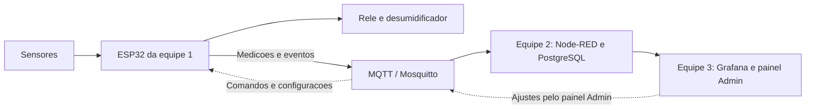

# MixNutri — Equipe 1

**Hardware e firmware para acompanhar o ambiente de uma sala de encapsulamento.**

Este projeto faz parte do Desafio 10 do NEOINDÚSTRIA MS, em parceria entre SENAI-MS e UCDB. A linha de encapsulamento tem quebras de cápsulas sem causa conhecida, e hoje a umidade é anotada à mão uma vez por dia. A proposta é medir temperatura e umidade continuamente, registrar quando a máquina para e cruzar esses dados com produto e lote, para ajudar a investigar as quebras.

Somos a **equipe 1, responsável pelo circuito eletrônico e pela programação do ESP32**. Começamos por uma sala piloto, com um único kit, e usamos simulação para desenvolver e testar antes de montar.

**Experimente agora no navegador, sem instalar nada:**

- [Item 1 — circuito e diagnóstico no Wokwi](https://wokwi.com/projects/479079864657061889)
- [Item 2 — firmware completo no Wokwi](https://wokwi.com/projects/479080199406642177)

## O que o ESP32 faz

- **Mede temperatura e umidade** com o sensor SHT31.
- **Liga e desliga o desumidificador por relé com histerese:** liga acima de um limite (ex.: 55% UR) e só desliga abaixo de outro (ex.: 50% UR). Um tempo mínimo entre comutações protege o compressor. Se o sensor falhar, o desumidificador desliga.
- **Percebe se a máquina parou pelo som:** se o ruído cai e continua baixo por alguns segundos, registra uma parada com início, fim e duração. Um silêncio rápido não conta.
- **Conversa por MQTT:** envia medições a cada 5 s e eventos sempre que algo muda, sempre com produto e lote, e recebe comandos AUTO/MANUAL, novos limites e o lote em produção. Responde a cada pedido dizendo se aceitou ou por que recusou.
- **Não perde dados quando a rede cai:** guarda as mensagens na memória Flash e reenvia em ordem quando a conexão volta, mesmo depois de reiniciar. O controle da umidade continua funcionando sem rede.
- **Modbus TCP opcional:** se a empresa liberar o acesso ao CLP da máquina, o estado pode vir direto dele em vez do som. Vem desligado por padrão.

## Hardware do MVP

Para simular no Wokwi não é preciso comprar nada. Para a montagem física escolhemos o caminho mais simples: **uma placa ESP32 clássica e módulos prontos**, sem placa de circuito própria e sem solda. Tudo na protoboard, alimentado pelo USB. É a mesma placa e são os mesmos pinos da simulação, então o firmware do Wokwi grava direto, sem alteração.

| Qtd. | Componente | Para quê |
| --- | --- | --- |
| 1 | Placa **ESP32 DevKit V1** (ESP32-WROOM-32, 4 MB) | Cérebro do kit: lê sensores, controla o relé, Wi-Fi. Já tem o LED azul usado como indicador de rede |
| 1 | Módulo **SHT31** (I²C, 3,3 V, endereço 0x44) | Temperatura e umidade. Os módulos prontos já trazem os resistores de pull-up |
| 1 | Módulo de microfone **MAX9814** (saída analógica) | Nível de ruído da máquina |
| 1 | Módulo **relé 1 canal** 5 V, **ativo em HIGH**, que aceite sinal de 3,3 V | Liga o desumidificador. Se o módulo for ativo em LOW, basta inverter `RELE_ON`/`RELE_OFF` no `sketch.ino` |
| 1 | LED + resistor de 330 Ω | Carga de demonstração ligada pelo relé |
| — | Protoboard, jumpers, cabo micro-USB **de dados** e fonte USB 5 V | Montagem, gravação e alimentação |

Ligações (iguais às do Wokwi):

| Módulo | Pino do módulo | Pino do ESP32 |
| --- | --- | --- |
| SHT31 | VCC / GND | 3V3 / GND |
| SHT31 | SDA / SCL | GPIO 21 / GPIO 22 |
| MAX9814 | VDD / GND | 3V3 / GND |
| MAX9814 | OUT | GPIO 34 (entrada analógica, funciona junto com o Wi-Fi) |
| Relé | VCC / GND | VIN (5 V do USB) / GND |
| Relé | IN | GPIO 26 |
| LED de rede | — | GPIO 2, LED azul da própria placa |
| LED de carga | nos contatos COM/NO do relé, com resistor | 3V3 → COM, NO → resistor → LED → GND |

Além do kit, só é preciso uma rede Wi-Fi de **2,4 GHz** e o servidor MQTT das outras equipes. Não há cartão SD nem Ethernet: a fila de mensagens fica na Flash interna do ESP32.

Na demonstração, o relé aciona apenas o LED. Ligar um desumidificador de verdade envolve rede elétrica: precisa de alguém habilitado, e o relé tem de ser escolhido conforme a potência do aparelho.

**Sobre a simulação:** no Wokwi, o SHT31 é um modelo parcial e o som é um sinal sintético. Servem para testar a lógica, mas não substituem os sensores reais, que ainda precisam ser testados na bancada. A pinagem completa está na [documentação do circuito](MixNutri/06%20Entregas/Item%201/Pinagem%20e%20componentes%20do%20item%201.md).

## Como nossa parte conversa com as outras equipes

A comunicação usa **MQTT**, um protocolo de troca de mensagens. O **Mosquitto** funciona como a central que recebe as mensagens e as entrega a quem precisa.

| Tópico (`mixnutri/sala01/...`) | Quem envia | O que vai |
| --- | --- | --- |
| `telemetria` | ESP32 | Temperatura, umidade, ruído, estado da máquina, relé, modo, produto e lote |
| `eventos` | ESP32 | Início e fim de parada, relé ligou/desligou, falha de sensor, reinício |
| `confirmacoes` | ESP32 | "Aceitei" ou "recusei, por este motivo" para cada pedido |
| `comandos` | Painel Admin | AUTO ou MANUAL ligado/desligado, com validade |
| `configuracao` | Painel Admin | Umidade máxima, histerese e limiar de ruído |
| `contexto` | Painel/backend | Produto e lote em produção |

- **Equipe 2:** infraestrutura, recebimento das mensagens e histórico no PostgreSQL.
- **Equipe 3:** dashboard no Grafana e painel de ajustes no Node-RED.

Os formatos completos, com exemplos reais, estão no [contrato MQTT](MixNutri/02%20Equipe%201/Contrato%20MQTT%20proposto.md) (seção "Versão 2"). São uma proposta para combinarmos juntos.

## Como testar no Wokwi

1. Abra o [projeto do item 2](https://wokwi.com/projects/479080199406642177) e clique em ▶.
2. No monitor serial aparecem linhas `ST` (estado a cada 2 s), `TEL` (telemetria) e `EVT` (eventos).
3. Clique no **SHT31** e suba a umidade para 60%: o relé liga. Volte para 49%: depois do tempo mínimo, desliga.
4. Clique no **som** e baixe o tom para 0%: após 5 s aparece `PARADA_INICIO`. Volte para 80%: `PARADA_FIM`, com a duração.
5. Digite `n` no serial para simular queda de rede: as mensagens vão para a Flash. Digite `n` de novo e elas são reenviadas.

Outros comandos do serial: `1`/`0` (MANUAL ligado/desligado), `a` (AUTO), `f` (estado da fila), `r` (reiniciar).

No Wokwi, o MQTT usa o broker público `broker.hivemq.com`, só para demonstração com dados sintéticos. No sistema de verdade, o endereço passa a ser o Mosquitto da equipe 2.

## Em que etapa estamos

| Entrega | Situação | Onde ver |
| --- | --- | --- |
| **Item 1:** circuito no Wokwi e script SQL | Pronto (versão 2), testado no Wokwi e no PostgreSQL | [Wokwi](https://wokwi.com/projects/479079864657061889) · [pasta](MixNutri/06%20Entregas/Item%201) |
| **Item 2:** firmware do ESP32 | Pronto e testado no Wokwi com MQTT de verdade, inclusive queda de rede e reinício sem perder mensagens | [Wokwi](https://wokwi.com/projects/479080199406642177) · [pasta](MixNutri/06%20Entregas/Item%202) |
| **Item 3:** ambiente de integração | Proposta da equipe 1 para a equipe 2 avaliar | [pasta](MixNutri/06%20Entregas/Item%203%20%28proposta%29) |
| **Itens 4 e 5:** dashboard e teste integrado | Com as equipes 2 e 3 | — |
| **Montagem física** | Lista de componentes e ligações definidas, iguais às do Wokwi; ainda não montada | Seção "Hardware do MVP" |

## Para as outras equipes

- **Banco de dados:** o [schema](MixNutri/06%20Entregas/Item%201/banco/01_schema.sql) tem as tabelas de telemetria, paradas, configuração de alertas e alertas emitidos, com os mesmos nomes de campo das mensagens.
- **Exemplo do que chega:** o [log das mensagens](MixNutri/06%20Entregas/Item%202/evidencias/mqtt-recebido-execucao-final.log) recebidas de uma execução no Wokwi.
- **Ferramenta de teste:** o [mqtt_mini.py](MixNutri/06%20Entregas/Item%202/ferramentas/mqtt_mini.py) assina e publica no broker usando só o Python.
- **Compatibilidade:** a [análise da entrega das etapas 3 e 4](MixNutri/06%20Entregas/Item%203%20%28proposta%29/Compatibilidade%20com%20a%20entrega%20das%20etapas%203%20e%204.md) lista as diferenças entre os contratos e as perguntas em aberto.

## Como o repositório está organizado

A pasta `MixNutri` também é um cofre do Obsidian: os links `[[assim]]` funcionam lá, e no GitHub aparecem como texto.

| Pasta | Conteúdo |
| --- | --- |
| `00 Contexto`, `01 Projeto` | Visão do desafio, escopo das equipes, requisitos e cronograma |
| `02 Equipe 1` | Arquitetura, controle de umidade, detecção de parada, parâmetros e contrato MQTT |
| `03 Simulacao` | Plano e limites da simulação, matriz de testes, evidências e uso do Wokwi CLI |
| `04 Memoria` | Decisões, pendências, tarefas e o registro de cada sessão de trabalho |
| `06 Entregas` | Itens 1, 2 e 3 com código, instruções, validação e evidências |
| `90 Fontes` | Referências técnicas e a entrega recebida da outra equipe (etapas 3 e 4) |

Ficaram fora deste repositório público os documentos originais do desafio, as transcrições deles e os contatos da coordenação: o material do desafio tem distribuição restrita ao SENAI-MS, à UCDB e à empresa. Senhas também não são publicadas; o ambiente do item 3 traz só um modelo (`.env.exemplo`).

## Limites

- Os valores (55/50% UR, limiares de ruído, tempos) são demonstrativos. Os limites reais dependem dos parâmetros da empresa.
- O ruído sai em **dBFS**, uma medida relativa ao conversor do ESP32, e não em dB SPL. Para virar decibéis de verdade, o microfone precisa ser calibrado na sala.
- Detectar parada pelo som pode errar com ruído de outras máquinas ou pessoas; os limiares precisam ser ajustados com áudio real. O MAX9814 tem ganho automático, que muda a amplitude, e isso também entra nesse ajuste.
- Umidade alta perto de uma parada não prova que uma causa a outra. Investigar as quebras depende de semanas de dados reais de produção, lote e qualidade.
