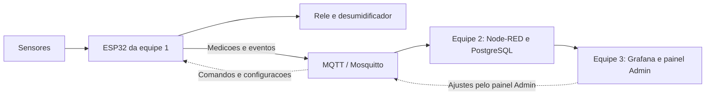

# MixNutri — Equipe 1

**Hardware e firmware para acompanhar o ambiente de uma sala de encapsulamento.**

Este projeto faz parte do Desafio 10 do NEOINDÚSTRIA MS, em parceria entre SENAI-MS e UCDB. A linha de encapsulamento tem quebras de cápsulas sem causa conhecida, e hoje a umidade é anotada à mão uma vez por dia. A proposta é medir temperatura e umidade continuamente, registrar quando a máquina para e cruzar esses dados com produto e lote, para ajudar a investigar as quebras.

Somos a **equipe 1, responsável pelo circuito eletrônico e pela programação do ESP32**. Começamos por uma sala piloto, com um único kit, e usamos simulação para desenvolver e testar antes de montar.

**Experimente agora no navegador, sem instalar nada:**

- [Item 1 — circuito e diagnóstico no Wokwi](https://wokwi.com/projects/479079864657061889)
- [Item 2 — firmware completo no Wokwi](https://wokwi.com/projects/479080199406642177)

## O que tem aqui

| Pasta | O que é | Como rodar |
| --- | --- | --- |
| [`item1-circuito-sql`](item1-circuito-sql) | Circuito do Wokwi, programa de diagnóstico e script SQL do banco | Wokwi no navegador; SQL com `psql` |
| [`item2-firmware`](item2-firmware) | Firmware do ESP32 e ferramenta de teste MQTT | Wokwi no navegador ou gravado no ESP32 |
| [`item3-integracao`](item3-integracao) | Kit com o lado do servidor: Mosquitto, PostgreSQL, Node-RED com painel Admin e Grafana | `docker compose up` |

Cada pasta tem o seu README com o passo a passo.

- **Simulação completa** (Wokwi + Docker, sem hardware): [guia de simulação](GUIA_SIMULACAO.md).
- **Kit físico** ligado ao banco e aos gráficos: [guia de montagem física](GUIA_MONTAGEM_FISICA.md).
- **Andamento do trabalho** (o que foi feito, testado e o que falta): [PROGRESSO.md](PROGRESSO.md).

## O que o ESP32 faz

- **Mede temperatura e umidade** com o sensor SHT31 (Wokwi) ou DHT11 (kit físico de bancada).
- **Liga e desliga o desumidificador por relé com histerese:** liga acima de um limite (ex.: 55% UR) e só desliga abaixo de outro (ex.: 50% UR). Um tempo mínimo entre comutações protege o compressor. Se o sensor falhar, o desumidificador desliga.
- **Percebe se a máquina parou pelo som:** se o ruído cai e continua baixo por alguns segundos, registra uma parada com início, fim e duração. Um silêncio rápido não conta.
- **Conversa por MQTT:** envia medições a cada 5 s e eventos sempre que algo muda, todos com produto e lote. Recebe comandos AUTO/MANUAL, novos limites e o lote em produção, e responde a cada pedido dizendo se aceitou ou por que recusou.
- **Não perde dados quando a rede cai:** guarda as mensagens na memória Flash e reenvia em ordem quando a conexão volta, mesmo depois de reiniciar. O controle da umidade continua funcionando sem rede.
- **Modbus TCP opcional:** se a empresa liberar o acesso ao CLP da máquina, o estado pode vir direto dele em vez do som. Vem desligado por padrão.

## Hardware do MVP

Para simular no Wokwi não é preciso comprar nada. O kit físico de bancada usa **uma placa ESP32 clássica, sensores simples e LEDs**, sem placa de circuito própria e sem solda. Tudo vai na protoboard, alimentado pelo USB.

O kit físico tem duas trocas em relação ao Wokwi: **DHT11** no lugar do SHT31 e **microfone P2 de eletreto** (com um pequeno circuito de polarização) no lugar do MAX9814. O firmware escolhe o sensor por [`hardware_fisico.h`](item2-firmware/firmware/hardware_fisico.h); a simulação continua com o SHT31.

| Qtd. | Componente | Para quê |
| --- | --- | --- |
| 1 | **ESP32-WROOM-32 DevKit**, 30 pinos | Lê sensores, controla o relé, Wi-Fi. O LED azul da placa indica a rede |
| 1 | **DHT11** (4 pinos) + resistor de 10 kΩ | Temperatura e umidade (20–90 %UR, ±5 %UR) |
| 1 | **Microfone P2 mono** + 2,2 kΩ, 2× 100 kΩ e capacitor de 1–10 µF | Ruído da máquina |
| 1 | **Módulo relé 5 V** (relé JQC-3FF-S-Z) | Liga o desumidificador (na bancada, o LED verde) |
| 3 | LEDs **verde**, **amarelo** e **vermelho** + resistores de 330 Ω | Desumidificador, máquina parada e umidade alta |
| — | Protoboard, jumpers e cabo USB **de dados** | Montagem, gravação e alimentação |

| Peça | Ligação no ESP32 |
| --- | --- |
| DHT11 | VCC 3V3, DATA **GPIO 4** (10 kΩ para 3V3), GND |
| Microfone | Circuito de polarização → **GPIO 34** (entrada analógica, funciona junto com o Wi-Fi) |
| Relé | VCC **VIN** (5 V), GND, IN **GPIO 26**; contatos: 3V3 → COM, NO → 330 Ω → LED verde → GND |
| LED amarelo | **GPIO 25** → 330 Ω → LED → GND |
| LED vermelho | **GPIO 27** → 330 Ω → LED → GND |
| LED de rede | GPIO 2, o LED azul da placa |

O passo a passo, com o circuito do microfone, o teste de bancada e a gravação pelo macOS/Linux, está no [guia de montagem física](GUIA_MONTAGEM_FISICA.md). Além do kit, é preciso uma rede Wi-Fi de **2,4 GHz** e o servidor MQTT. Não há cartão SD nem Ethernet: a fila de mensagens fica na Flash interna do ESP32.

Na demonstração, o relé aciona apenas o LED. Ligar um desumidificador de verdade envolve rede elétrica: precisa de alguém habilitado, e o relé tem de ser escolhido conforme a potência do aparelho.

No Wokwi, o SHT31 é um modelo parcial e o som é um sinal sintético. O DHT11 e o microfone sem amplificador servem para a bancada; para a sala de encapsulamento, o SHT31 (±2 %UR) e um microfone com amplificador continuam recomendados.

## Como nossa parte conversa com as outras equipes

A comunicação usa **MQTT**, um protocolo de troca de mensagens. O **Mosquitto** funciona como a central que recebe as mensagens e as entrega a quem precisa.

| Tópico (`mixnutri/sala01/...`) | Quem envia | O que vai |
| --- | --- | --- |
| `telemetria` | ESP32 | Temperatura, umidade, ruído, estado da máquina, relé, modo, produto e lote |
| `eventos` | ESP32 | Início e fim de parada, relé ligou/desligou, falha de sensor, reinício |
| `confirmacoes` | ESP32 | "Aceitei" ou "recusei, por este motivo" para cada pedido |
| `disponibilidade` | ESP32 / broker | `online` ao conectar; `offline` se a conexão cair |
| `comandos` | Painel Admin | AUTO ou MANUAL ligado/desligado, com validade |
| `configuracao` | Painel Admin | Umidade máxima, histerese e limiar de ruído |
| `contexto` | Painel/backend | Produto e lote em produção |

- **Equipe 2:** infraestrutura, recebimento das mensagens e histórico no PostgreSQL.
- **Equipe 3:** dashboard no Grafana e painel de ajustes no Node-RED.

Para integrar:

- **Contrato MQTT:** o [contrato completo](item3-integracao/docs/contrato-mqtt-v2.md) traz campos, tipos e regras.
- **Banco:** o [schema do banco](item1-circuito-sql/banco/01_schema.sql) usa os mesmos nomes de campo das mensagens.
- **Guia:** o [guia de integração](item3-integracao/docs/guia-integracao-equipe2.md) mostra o que adotar no servidor.
- **Exemplo real:** o [exemplo de mensagens](item2-firmware/exemplos/mqtt-exemplo.log) foi gravado de uma execução no Wokwi, com dados sintéticos.

## Em que etapa estamos

| Entrega | Situação |
| --- | --- |
| **Item 1:** circuito no Wokwi e script SQL | Pronto (versão 2), testado no Wokwi e no PostgreSQL |
| **Item 2:** firmware do ESP32 | Pronto e testado no Wokwi com MQTT de verdade, inclusive queda de rede e reinício sem perder mensagens. Cliente Modbus testado por rede contra o simulador |
| **Item 3:** kit de integração | Proposta da equipe 1 para a equipe 2 avaliar. Testado ao vivo com o firmware rodando no Wokwi, por uma ponte com o broker público |
| **Itens 4 e 5:** dashboard e teste integrado | Com as equipes 2 e 3. O roteiro do item 5 (UR alta → relé → parada → alerta no Grafana) já roda em simulação com o kit da equipe 1 |
| **Montagem física** | Kit de bancada definido (DHT11, microfone P2, relé e LEDs). ESP32 gravado e rodando o teste de bancada pelo macOS; sensores e relé ainda a ligar e validar |

## Limites

- Os valores (55/50% UR, limiares de ruído, tempos) são demonstrativos. Os limites reais dependem dos parâmetros da empresa.
- O ruído sai em **dBFS**, uma medida relativa ao conversor do ESP32, e não em dB SPL. Para virar decibéis de verdade, o microfone precisa ser calibrado na sala.
- Detectar parada pelo som pode errar com ruído de outras máquinas ou de pessoas. Os limiares precisam ser ajustados com áudio real (o teste de bancada tem uma calibração). Microfones com ganho automático, como o MAX9814, mudam a amplitude, e isso também entra nesse ajuste.
- Umidade alta perto de uma parada não prova que uma causa a outra. Investigar as quebras depende de semanas de dados reais de produção, lote e qualidade.
- Senhas não são publicadas. O kit de integração traz só um modelo (`.env.exemplo`) para cada equipe preencher.
